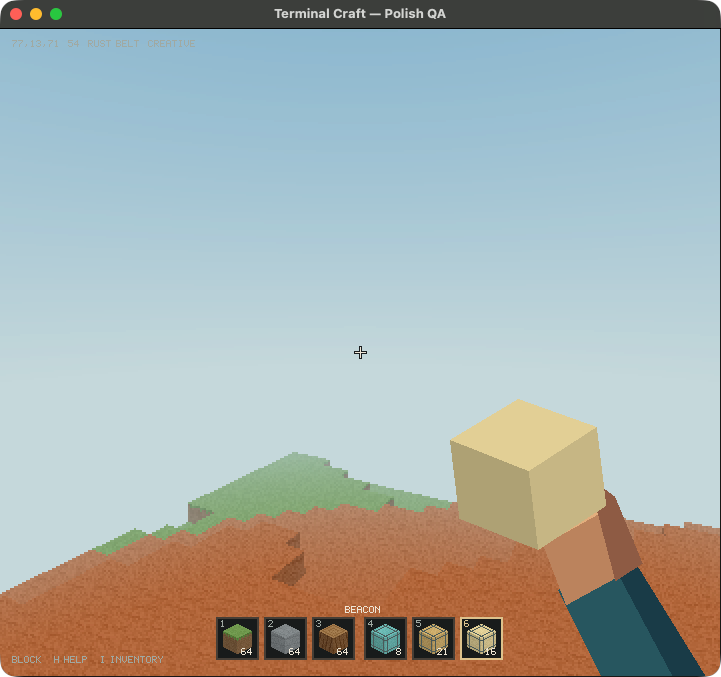

# Terminal Craft



## System Abstract

Terminal Craft is a native Rust voxel sandbox with a single codebase that runs in two hosts: a pointer-locked native SDL2 window and a terminal host (Kitty graphics transport or ANSI half-block fallback). Both hosts share the same game engine, renderer, repository, and save format. The current release focuses on keyboard-and-mouse navigation for a bounded single-player sandbox; mobs, combat, and multiplayer are not present.

Status: native window with real pointer-locked mouse look; terminal rendering remains available as an option. The source distribution is published under an "all rights reserved" license; publication does not change those terms.

Repository: [janestreetshiller/terminal-craft](https://github.com/janestreetshiller/terminal-craft).

## Architecture and System Design

- **Hosts**: the native window uses SDL2 (built and statically linked by Cargo via the `sdl2` crate with bundled sources). The terminal host uses crossterm/libc input and the Kitty graphics transport with an ANSI half-block fallback. Kitty mode negotiates press/repeat/release reporting and uses a verified input probe; other terminals may fall back to a 400 ms key-hold behavior. Terminal mode cannot provide native pointer lock or native-window fullscreen.
- **Engine**: seeded procedural voxel terrain with trees and six themed regions; deterministic map generation; first-person view with held blocks and pickaxe/axe/shovel tools with material-specific speeds; movement with walking, normalized diagonal movement, sprint, sneak (lowered view), jump, and creative flight; 70-degree interaction rays; mining cracks; textured HUD/hotbar; debug/FPS overlay.
- **User interface**: Gilded (default) and Classic skins with live switching (F6); the skin changes appearance only, not gameplay or saves. `TERMINAL_CRAFT_UI` selects the initial style.
- **Worlds**: five embedded prebuilt templates — Foundry, Switchyard, Citadel, Skybridge, and Dune Outpost — each an original, fixed arena with its own editable and resumable save. Templates are embedded, not downloaded community maps. See `docs/prebuilt-worlds.md` for details and verification limits.
- **Persistence**: atomic save format (v1/v2 readable). Default save: `~/.local/share/terminal-craft/world.tcrf` (or `$XDG_DATA_HOME/terminal-craft/world.tcrf`); a legacy native save at `~/.local/share/tuicraft/world.tcrf` is copied on first launch when no new-name save exists.

## Prerequisites and Toolchain

- Rust 1.88+ with Cargo.
- CMake and a C/C++ compiler with the macOS SDK command-line tools (SDL is built and statically linked by Cargo; the installed native application needs neither Homebrew SDL nor Kitty).
- Python 3 for packaging and integration tests.

## Build and Verification Protocol

```sh
git clone https://github.com/janestreetshiller/terminal-craft.git
cd terminal-craft
cargo test --locked
cargo fmt --check
cargo clippy --all-targets --locked -- -D warnings
python3 scripts/install_macos.py
python3 scripts/verify.py
```

`bin/terminal-craft` builds the release binary if missing. The installer builds into a private temporary target, backs up previous application bundles, and embeds a source/binary SHA-256 manifest. To repair CLI aliases without rebuilding, run `python3 scripts/repair_cli_links.py`.

## Interface and Specification

### Command line

```sh
terminal-craft                       # native window, Gilded UI (default)
terminal-craft --gilded              # explicitly select Gilded
TERMINAL_CRAFT_UI=classic terminal-craft
terminal-craft --terminal            # dedicated Kitty window
terminal-craft --here                # use existing terminal
terminal-craft --map foundry         # launch a prebuilt world
terminal-craft --check-save /path/to/world.tcrf
terminal-craft --help
cargo run --release -- --native      # native host directly from source
```

Installed application: `/Applications/Terminal Craft.app`; CLI aliases `terminalcraft` and `termcraft`. The separate browser game (`block-craft` / `/Applications/Block Craft.app`) is not included in this repository.

### Controls

- WASD: move (diagonal normalization)
- Mouse / arrows: look (native mouse uses relative motion)
- Space: jump / ascend in flight
- Ctrl: sprint
- Shift / Z: sneak (slow, lowered view) / descend in flight
- Hold left mouse / E / F: mine / swing
- Right mouse / Q / Tab: place selected block
- 0: empty hand
- 7/8/9: pickaxe / axe / shovel
- 1–6: select hotbar block
- Wheel / `[` / `]`: cycle blocks
- H / I: controls, inventory and recipes (pauses)
- M: overhead map (pauses)
- C: toggle creative mode
- G / double Space: toggle flight (creative)
- F3: debug info
- F6: switch Classic/Gilded UI
- F11: native fullscreen
- R: save
- Esc: close overlays or pause and release pointer
- Ctrl-Q / Ctrl-C: save and quit

### Environment variables

- `TERMINAL_CRAFT_UI=classic|gilded`: initial UI style
- `TERMINAL_CRAFT_SAVE`: explicit world path
- `TERMINAL_CRAFT_SENS`: mouse sensitivity (default `0.0024`)
- `TERMINAL_CRAFT_QUALITY=native`: full-resolution world sampling
- `TERMINAL_CRAFT_ASCII=1`: ASCII/text fallback in terminal mode
- `TERMINAL_CRAFT_KITTY`: optional terminal-host executable

Legacy aliases `TUICRAFT_SAVE`, `TUICRAFT_ASCII`, `TUICRAFT_SENS` are retained as fallbacks.

## Provenance and Documentation

- `docs/source-import.json` records imported files and SHA-256 hashes; historical snapshots were retained during import to preserve provenance.
- Verification reports are in `docs/` and `docs/verification/`; see `docs/public-launch-verification.md` and `docs/prebuilt-repair-status.md` for candidate/release verification details.
- `docs/README.md` is the full documentation index (maps, verification, provenance, and publication drafts).

## License

This repository is published under an "all rights reserved" policy. Publication here does not change licensing terms; any licensing change is an owner decision.
